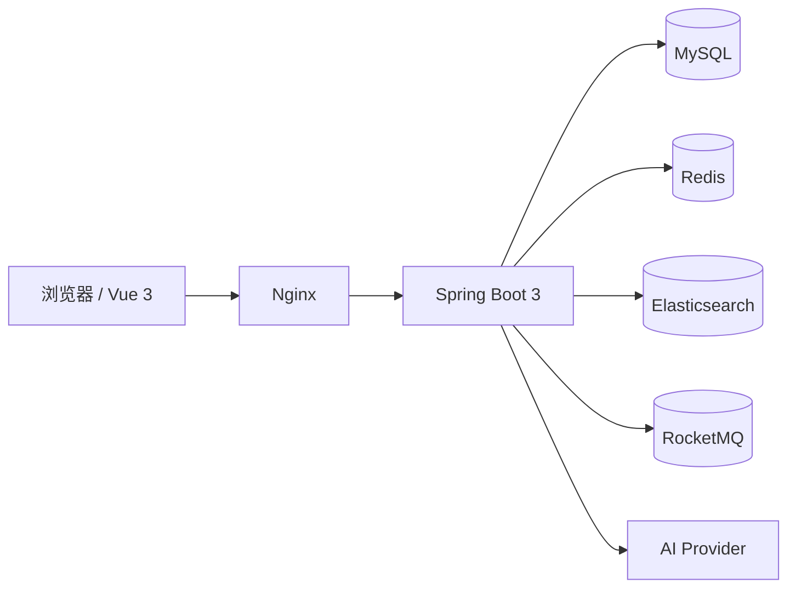

# AI 驱动的多用户内容平台

AI-powered multi-user blogging platform · Spring Boot 3 + Spring AI + Vue 3

一个从博客出发的多用户内容创作平台，在基础内容能力之上构建了**全站 AI Assistant**：
意图路由、RAG 检索、长期记忆、Agent Runtime、多目标编排与受控写动作。

## 功能一览

- **内容**：文章 CRUD（Markdown）、分类 / 标签、评论与点赞、文章点赞收藏、关注作者、公开用户主页
- **搜索**：Elasticsearch 全文检索（IK 分词 + 多字段权重 + 高亮 + 降级）、搜索独立页
- **AI 助手**：SSE 流式对话、页面上下文感知、当前文章问答、Tool Calling、思考过程展示
- **RAG**：ES 向量 + keyword 混合检索、模型 rerank、相关性 Gate、MySQL 兜底、引用来源展示
- **长期记忆**：正式记忆 / 候选确认 / 相似记忆召回 / LLM 更新决策 / prompt 注入
- **Agent**：四域 Runtime（学习 / 文章 / 通用 / 钱包）、5 个 Workflow、TaskPlan 编排、受控写动作
- **钱包与计费**：余额流水、充值订单（订单 / 支付单分离）、秒杀发放额度、AI 用量计费
- **工程化**：Redis 缓存可靠性 / 限流 / 分布式锁 / 幂等 / 乐观锁 / traceId / 健康检查
- **消息**：RocketMQ（AI 记忆事件、文章索引同步）

## 技术栈

| 层 | 技术 |
|---|---|
| 后端 | Spring Boot 3、Spring AI、MyBatis-Plus、MySQL 8、Redis、Elasticsearch、RocketMQ |
| 前端 | Vue 3（Composition API）、Vite、Axios、Naive UI |
| 部署 | Linux、Nginx |

## 架构概览



## 目录结构

```text
blog-system/     后端（Spring Boot 3）
blog-frontend/   前端（Vue 3 + Vite）
docs/            设计文档、复盘记录、评测报告、面试笔记
deploy/          部署配置与压测脚本
db/              建库脚本与迁移 SQL
```

## 快速开始

后端：

```bash
cd blog-system
./mvnw spring-boot:run
```

需要 JDK 17+、MySQL 8、Redis、Elasticsearch。本地默认连接 `blog_system` 库（用户名 `myRoot`，密码 `123456`）。

前端：

```bash
cd blog-frontend
npm install
npm run dev
```

## 文档

设计文档、踩坑记录与评测报告都在 `docs/`：

- 项目历史与里程碑：`docs/project-history.md`
- Agent 能力设计：`docs/agent/`
- RAG 检索与评测：`docs/rag-notes/`
- Redis / 工程化：`docs/redis/`
- 消息队列：`docs/mq/`
- 面试笔记：`docs/interview/`

## 开发说明

本项目由 AI 辅助开发（Claude、Codex），工程约定见 [AGENTS.md](AGENTS.md)。

## License

[MIT](LICENSE)
