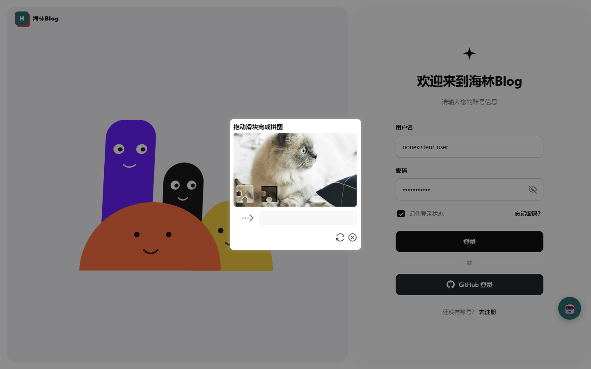

# 登录 / 注册行为验证码设计

> 2026-10-15 实施完成。后端 Spring Boot 3.5 + tianai-captcha 1.5.5，前端 Vue3 + tianai web-sdk（源码自构建）。



> 截图来自端到端验证（Playwright 打开真实登录页、点「登录」后弹出）。
> 背景图是 tianai jar 自带的那张 600×360；缺口位置每次随机。

## 1. 选型：为什么不是「字母数字 / 算术」图形码

最初的设想是经典图形验证码（一张小图 + 输入框），库里也有现成实现（Hutool `cn.hutool.captcha`
已在依赖里、kaptcha、easy-captcha）。放弃它的原因只有一条：

**图形码已经被 OCR + 打码平台攻破**（识别率 95%+、单次成本约两分钱）。它现在的真实价值只剩
「抬高最廉价那批脚本的成本」，挡不住认真的人。

行为验证码判的是**滑动轨迹本身**（终点位置精度 + 轨迹的平滑度/加减速），攻击者要过就得
模拟人类轨迹，成本高一个量级。代价是交互形态从「输入字符」变成「拖动滑块弹窗」——这是
需求层面的改变，不是实现层面的。

开源方案里选 tianai 的理由：国内活跃维护（dromara 组织）、`jakarta.servlet` 原生兼容
Spring Boot 3、检测到 Redis 就自动把验证码数据存 Redis（多实例可用）。

## 2. 架构与数据流

```
前端点「登录」→ 弹滑块
  ↓ POST /api/auth/captcha            （生成：背景图+滑块图 base64 + captchaId）
  ↓ 用户拖动 → POST /api/auth/captcha/check  （提交明文轨迹）
      └─ 服务端 SimpleImageCaptchaValidator：|(末点x - 首点x)/bgImageWidth - 缺口百分比| ≤ 0.02
      └─ 通过 → SecondaryVerificationApplication 写一条一次性记录 captcha:secondary:{id}
  ↓ 前端拿 res.data.token（就是 captchaId）
POST /api/auth/login { username, password, captchaVerification: captchaId }
      └─ CaptchaVerifier.secondaryVerification(id) —— getAndRemove，**消费即销毁**
      └─ 通过 → 才进入限流检查 → 查库 → bcrypt
```

**二次验证是这套方案唯一的服务端兜底，必须开**（`captcha.secondary.enabled=true`）。
只有第一次 `matching` 的话，攻击者绕过前端直接 POST 登录接口就完全跳过了验证码。

启动期由 `CaptchaVerifier` 的构造器 fail-fast 校验这一项：配成 false 时
`imageCaptchaApplication` 不是 `SecondaryVerificationApplication`，直接启动失败——
否则运行时的表现是「登录永远报验证码失效」，几乎无法归因。

## 3. 顺序：验证码必须排在限流之前

`LoginServiceImpl.login()` 里的顺序是 **验证码 → `checkBlocked` → 查库 → bcrypt**。

反过来（限流在前）会放大 `LoginAttemptLimiter` 的已知残留代价：任何人拿别人的用户名
连刷无效凭证，就能把真实账号锁死 15 分钟。验证码没通过**不代表密码错**，不该计入失败次数。

## 4. 五个踩坑（都实测踩过）

| # | 现象 | 根因 | 解法 |
|---|---|---|---|
| 1 | 生成接口返回 40001「请求的资源数量超过可用资源总数」 | `captcha.init-default-resource=true` 走的是 `TACBuilder.addDefaultTemplate` → `DefaultBuiltInResources`，其 `PATH_PREFIX` 是 `.../cut-image/template`，**只装模板不装背景图** | `CaptchaResourceConfig` 显式 `store.addResource(SLIDER, ...)`，引用 jar 自带的 600×360 背景图 |
| 2 | 前端提交的 `data` 是**密文**（带 `drives`/`ki` 字段），后端解析不出轨迹 | minio 上 223KB 那版 tac 比后端新，要求后端支持解密 | 从 `dromara/tianai-captcha` 源码 `npm run buildprod` 自构建（产物 64KB） |
| 3 | 175KB 那版 tac 连生成接口都解析不了（`Cannot read properties of undefined`） | 更老的版本，响应结构不同 | 同上，用与后端配对的源码版本 |
| 4 | 套一层项目 `Result` 后验证码整块不显示 | SDK 硬判定 `if (!data.code) throw` / `data.code === 200`，而项目成功码是 **0** | `/api/auth/captcha/**` 两个端点直接返回 tianai 原生 `ApiResponse` |
| 5 | 凭证消费后用户重试一直报「验证已失效」 | 凭证是一次性的（`getAndRemove`） | 前端登录/注册**失败后清空 `form.captchaVerification`**，下次提交重新弹滑块 |

另外两条设计约定：

- **Redis 故障时 fail-open（放行）**：与 `LoginAttemptLimiter` 同一取舍——拒绝会让 Redis
  一抖等于全站登不进去；放行的风险有外层限流 + 每次约 100ms 的 bcrypt 兜底。
- **背景图放在 `LocalMemoryResourceStore`（而非 starter 默认的 `RedisResourceStore`）**：
  图片打包在 jar 里，每个实例自读 classpath 即可，不必把图片本体塞进 Redis。
  真正必须共享的是**验证码数据**（`CacheStore`），那部分仍然是 Redis。

## 5. 验证方法（可复现，无数据副作用）

后端接口层面：

```bash
# 生成：必须是 200 + SLIDER（这个 200 是 SDK 的硬要求）
curl -X POST -H 'Content-Type: application/json' -d '{}' localhost:8080/api/auth/captcha

# 缺凭证 → 40001「请先完成安全验证」；伪造凭证 → 40002「验证已失效」
curl -X POST -H 'Content-Type: application/json' \
  -d '{"username":"nobody","password":"x","captchaVerification":"fake"}' \
  localhost:8080/api/auth/login
```

真实浏览器（Playwright，见 `.tmp-tianai/e2e/drag_login.py` 的脚本形态）：

1. 从 Redis 读当前验证码的缺口比例 `captcha:SLIDER_*` → 值是 `{"type":"SLIDER","percentage":0.49}`
2. 拖动距离 = `percentage × 背景图显示宽度`（实测 SDK 提交的 `bgImageWidth` 是**显示尺寸** 300，不是原始 600）
3. **用不存在的账号登录**，断言响应是 **40101（用户名或密码错误）而不是 40002**

第 3 条是关键：拿到 40101 说明「滑块 → 二次验证 → 登录」整条链路真的打通了，且不写任何数据。

## 6. 已知残留

- **背景图只有 1 张**（tianai jar 自带的 `META-INF/cut-image/resource/1.jpg`）。缺口位置每次都随机，
  功能与安全性不受影响，只是视觉单调。要多张就往 `CaptchaResourceConfig` 里多 `addResource` 几条
  （背景图需 600×360）。
- **前端 SDK 产物是构建物**，放在 `blog-frontend/public/static/`（`tac/js/tac.min.js` 约 64KB、
  `tac/css/tac.css`、`tac/images/*`、`js/load.min.js`）。升级后端 tianai 版本时**必须重新构建它**，
  否则会重现踩坑 #2。
- **许可证**：tianai-captcha 是 **MulanPSL-2.0**（木兰宽松许可证），公网部署时保留其版权声明即可。
